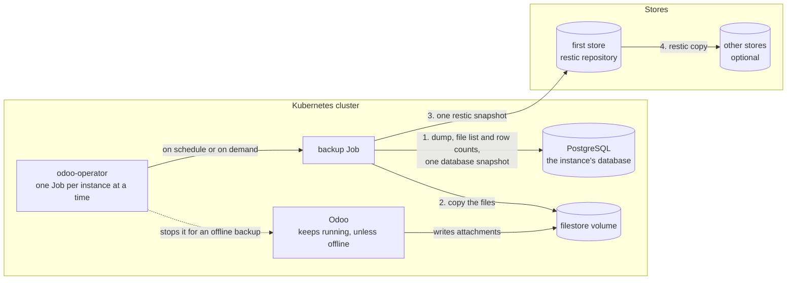
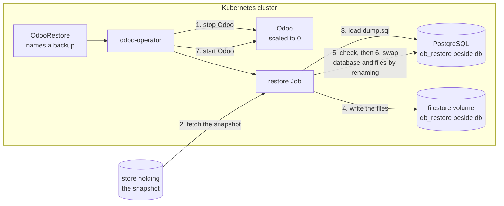

# How backups work

This page explains what a backup is and where it goes. The guides show how to
[set up a store](../guides/backup-stores.md), [take and schedule
backups](../guides/backups.md), [restore](../guides/restore.md) and [run
restore drills](../guides/drills.md).

## Stores and repositories

Every store holds [restic](https://restic.net/) repositories, one
per instance under `<path>/<namespace>/<deployment>/`, encrypted with the key
in `encryptionKeySecret` (keep a copy of it outside the cluster: without it no
backup can be read). The kinds of store and their settings are in [Set up a
backup store](../guides/backup-stores.md).

## Taking a backup

1. The Job dumps the database and, from the same database snapshot, lists
   the files the database refers to and counts each table's rows.
2. It copies those files from the filestore. A file deleted since the dump
   is taken from the previous backup.
3. It writes `dump.sql`, `manifest.json` and `filestore/` as one restic
   snapshot to the first store, then applies retention there.
4. It copies the snapshot to every other store listed, and applies retention
   in each; a [zip store](../guides/backup-stores.md#zip-stores) gets it as an
   Odoo zip instead.

## What a backup holds

A backup is one restic snapshot holding `dump.sql` (a plain `pg_dump`
taken with a `pg_dump` of the server's major), `manifest.json` (Odoo's own
format, plus an `operator` key) and the `filestore/`, so it is also what
Odoo's database manager restores. Online backups run beside Odoo: the dump,
the attachment list and the row counts all come from one database snapshot, so
they agree with each other. Files that disappeared from the filestore since
(Odoo's attachment cleanup) are taken from the previous backup; attachments in
neither are listed in `status.missingFileNames` and the backup ends
`CompletedWithWarnings`. An online backup waits up to two hours for Odoo's
filestore cleanup cron to finish when it is running or due within ten minutes
(phase `WaitingForFilestoreCleanup`). With a `ReadWriteOncePod` data volume,
or `consistency: Offline`, Odoo is stopped while the backup runs.

## Phases of an OdooBackup

| `OdooBackup` phase | Meaning |
|---|---|
| `Pending` | Waiting for the instance: one backup, restore or cleanup runs at a time, and backups wait for init, upgrades and rollouts. |
| `WaitingForFilestoreCleanup` | Odoo's filestore cleanup runs or is due; tried again every two minutes. |
| `Running` | The Job runs. |
| `Completed` / `CompletedWithWarnings` | `status.snapshotID` holds it. |
| `PartiallyCompleted` | The backup is in the first store, but a [copy](../guides/backups.md#copies) to another store failed; `status.copies` says why. |
| `Failed` | `status.message` names the step that failed and the Job to read. |

Deleting an OdooBackup does not delete the snapshot, and deleting an
instance never deletes its backups.

## Restoring

Nothing live changes until the swap:

1. Odoo is stopped (the maintenance page shows, when enabled).
2. The Job fetches the snapshot, from a copy in another store when the
   backup's own store is not ready.
3. It loads `dump.sql` into a new database, `<db>_restore_<suffix>`.
4. It writes the files into `filestore/<db>_restore_<suffix>`, beside the
   live ones.
5. It checks the result: every table's row count must match the backup and
   every attachment the backup holds must be there, or the restore stops with
   the live data untouched. A sample of files is also compared with its
   checksum; a mismatch is a warning in the OdooRestore's status, since those
   files were already damaged when the backup was taken.
6. It swaps by renaming: the live database and files become
   `<db>_prev_<suffix>`, kept for `keepPrevious` (72 hours by default) so the
   restore can be undone, and the restored ones take their names.
7. Odoo starts on the image recorded in the backup.

The details, and how to undo a restore, are in
[Restore and undo](../guides/restore.md).

## The backup image

The Jobs run `ghcr.io/mohanadabugharbia/odoo-operator-backup`
at the operator's own tag (derived from the operator's image; `--backup-image`
overrides it). An operator image pinned by digest only has no tag to derive it
from, and gets `:latest`: set `--backup-image` for such installs. It carries the PostgreSQL 14–18 clients, restic, rclone and the
`odoo-backup` agent, and runs as the instance's pod security context with no
service account token.
