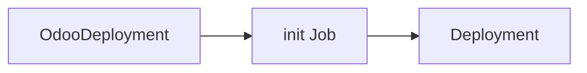

# Writing the docs

The site is built with [MkDocs](https://www.mkdocs.org/) and
[Material for MkDocs](https://squidfunk.github.io/mkdocs-material/) from the
`docs/` folder, and published to GitHub Pages. A change in behaviour and the
change to its page go in the same pull request.

## Build and preview locally

```sh
make docs-serve    # http://127.0.0.1:8000, reloads on every save
make docs-build    # what CI runs: fails on any warning, such as a broken link
```

Both create a Python virtual environment under `bin/docs-venv` from
`docs/requirements.txt` on first use.

## Generated pages

`docs/reference/api.md` and `docs/reference/metrics.md` are generated; do not
edit them. After changing a type in `api/v1` or a metric in
`internal/metrics`, run:

```sh
make docs-reference
```

and commit the result. CI fails a pull request whose generated pages are
stale.

- The API reference comes from the Go types and their comments, through
  [crd-ref-docs](https://github.com/elastic/crd-ref-docs)
  (`hack/docs/crd-ref-docs.yaml`).
- The metrics reference comes from the metrics the operator registers
  (`metrics.Reference`, written out by `hack/docs`). A new metric must be
  added to the `registered` list in `internal/metrics/metrics.go`, or to the
  `Collector`, to be exported at all, so it cannot be left out of the page.

## Preview a pull request

Add the **docs-preview** label to a pull request. The site of that pull
request is then published at
`https://odoo-operator.abugharbia.com/pr-preview/pr-<number>/`,
a comment on the pull request links to it, and every push updates it.
Removing the label or closing the pull request deletes the preview.

Pull requests from forks get no preview: their workflows cannot write to the
repository. Every pull request, labelled or not, still builds the site.

## Published versions

| When | Published as |
|---|---|
| A push to `main` | `dev` |
| A release | its `major.minor` (for example `0.6`), also `latest`, the default |

[mike](https://github.com/jimporter/mike) keeps one folder per version on the
`gh-pages` branch, and the version picker in the header switches between
them.

## Diagrams

Fenced `mermaid` blocks render as diagrams:

````markdown

````
