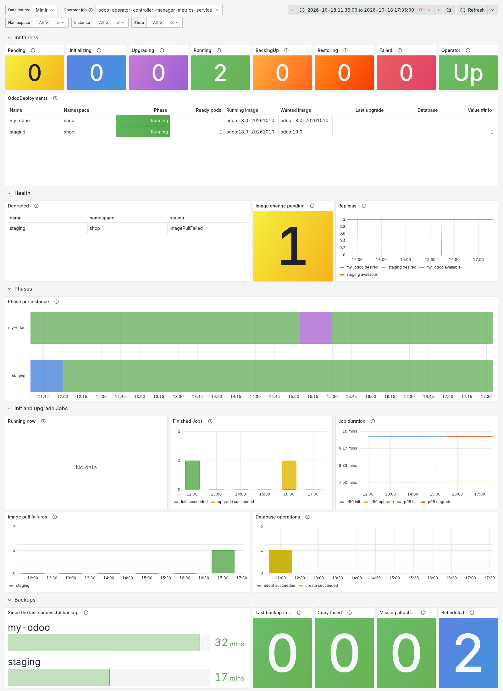

# Grafana dashboard

The repository ships a Grafana dashboard for the operator's
[metrics](../reference/metrics.md):
[`config/grafana/odoo-operator-dashboard.json`](https://github.com/MohanadAbugharbia/odoo-operator/blob/main/config/grafana/odoo-operator-dashboard.json).



*The top of the dashboard, with sample data: two instances, one of them Degraded after an image pull failure.*

## What it shows

| Row | Panels |
|---|---|
| Instances | how many OdooDeployments are in each phase, whether the operator is up, and a table of every instance with its phase, image and applied image |
| Health | Degraded instances with their reason, pending image changes, and desired against available replicas |
| Phases | the phase of every instance over time |
| Init and upgrade Jobs | the Jobs running now and for how long, finished Jobs by result, Job duration (median and 95th percentile), image pull failures, database operations |
| Backups | time since each instance's last successful backup, failed backups and copies, missing attachments, scheduled instances, backup sizes, finished backups by kind and result, backup duration |
| Restores and drills | time since each instance's last passing drill, failed drills and restores, restores and undos by result |
| Backup stores | whether each store is ready, time since its last check and prune, failed checks and prunes, and what it holds |
| Odoo pods | CPU, memory against its limit, restarts, and how full each filestore volume is |
| Operator | reconciles, reconcile errors and time, the work queue, the manager's memory, API client errors, and the running version |

The thresholds of "time since" panels (backups: a day and two, drills and
store tasks: eight and fifteen days) suit a daily backup and a weekly drill;
change them to your schedules, as with the [example
alerts](monitoring.md#alerts).

The selectors at the top pick the Prometheus data source and the operator's
scrape job, and narrow the panels to some namespaces, instances and stores.

## Requirements

- Prometheus (or a compatible store such as Mimir or Thanos) scraping the
  manager's `/metrics`; [Monitoring and alerts](monitoring.md) shows how.
  The **Operator job** selector lists the jobs that export
  `odoo_operator_build_info`; with a ServiceMonitor on the install bundle's
  metrics Service it is `odoo-operator-controller-manager-metrics-service`.
- The scrape must keep the series' own `namespace` label (`honorLabels: true`
  on a ServiceMonitor, `honor_labels: true` in a scrape config): the
  per-instance series carry the namespace of their OdooDeployment, which
  Prometheus would otherwise rename to `exported_namespace`, leaving the
  namespace selector with only the operator's namespace.
- For the **Odoo pods** row: the kubelet's cAdvisor and volume metrics
  (`container_cpu_usage_seconds_total`, `container_memory_working_set_bytes`,
  `kubelet_volume_stats_*`) and kube-state-metrics
  (`kube_pod_container_resource_limits`,
  `kube_pod_container_status_restarts_total`). Without them that row stays
  empty and the rest works.

## Import it

In Grafana, **Dashboards → New → Import**, paste the JSON (or the raw URL of
the file), and pick your Prometheus data source.

With the Grafana Helm chart's dashboard sidecar, a ConfigMap with the
`grafana_dashboard` label loads it instead:

```yaml
# kustomization.yaml
configMapGenerator:
  - name: dashboard-odoo-operator
    files:
      - odoo-operator.json=odoo-operator-dashboard.json
generatorOptions:
  disableNameSuffixHash: true
  labels:
    grafana_dashboard: "1"
```

The dashboard's uid is `odoo-operator`, so links to it stay valid across
imports.
