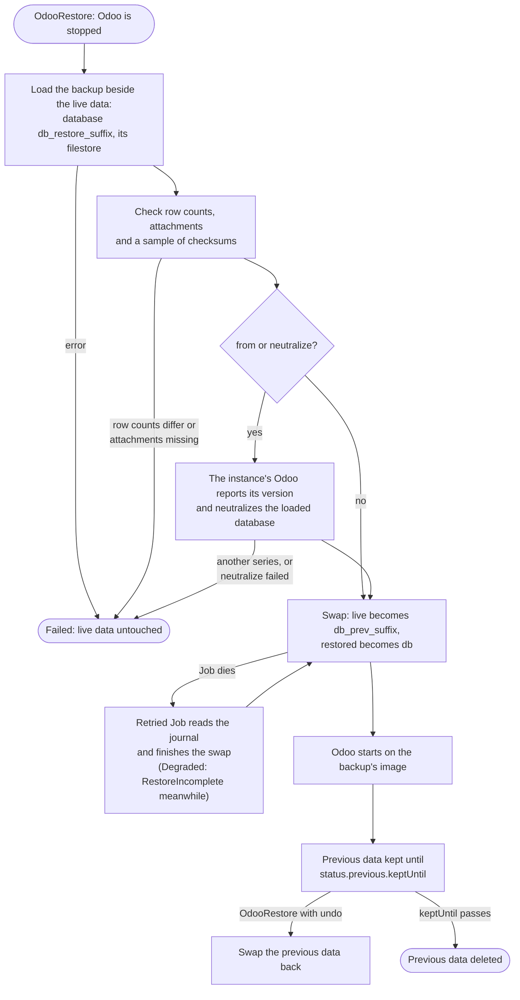

# Restore and undo

A restore replaces the instance's database and filestore in place:

```yaml
apiVersion: odoo.abugharbia.com/v1
kind: OdooRestore
metadata:
  name: back-to-friday
  namespace: shop
spec:
  odooDeployment: my-odoo
  backup: my-odoo-2026-10-17        # or snapshotID: <id> in the instance's store
  keepPrevious: 72h                 # default spec.backup.restore.keepPrevious (72h)
```

Odoo is stopped; the backup is loaded into `<db>_restore_<suffix>` and
`filestore/<db>_restore_<suffix>` beside the live data and checked: every
table's row count must match the backup and every attachment the backup holds
must be there. A sample of files is also compared with its checksum; a
mismatch only adds a warning to `status.warnings`, as those files were damaged
before the backup. Only then are the names swapped: the live data
becomes `<db>_prev_<suffix>` and the restored data takes its place, and Odoo
starts on the image recorded in the backup. A restore that fails before the
swap leaves the live data untouched (`Failed`); one that fails during the swap
is retried until it finishes, with Odoo stopped and the instance `Degraded`
(`RestoreIncomplete`). A restore takes precedence over everything else and
replaces a failed init or upgrade Job, which makes it the way back from a
failed upgrade. Modules in `spec.modules` that the backup lacks are installed
again afterwards.

The instance then counts as running the backup's image and upgrade token. If
`spec.image` differs from the backup's image, the usual upgrade follows when
`spec.upgrade.onImageChange` is true; if `spec.upgrade.token` differs from the
backup's, an upgrade follows either way. Set both to the backup's values first
to stay on it.

A restore by `backup` falls back to a copy in another store when the backup's
store is not ready. A restore by `snapshotID` reads only the first store in
`spec.backup.stores`.

## Restore a backup from elsewhere

`from` restores a backup that is not one of the instance's own OdooBackups:
a backup file made by Odoo's database manager, or a snapshot in any restic
repository the operator wrote, such as another instance's. It names an
[OdooBackupStore](backup-stores.md) in the same namespace and a path in it;
the store does not have to be in `spec.backup.stores`, and is best made
[`readOnly`](backup-stores.md#read-only-stores):

```yaml
spec:
  odooDeployment: my-odoo
  from:
    store: imports
    path: exports/shop_*.zip       # a .zip or .dump file; the last segment may be a pattern
  neutralize: true                 # for a copy of production, see below
```

| `path` | Restores |
|---|---|
| ends in `.zip` | Odoo's zip backup: `dump.sql`, `manifest.json` and the `filestore/` folder, at the top of the zip or one folder down (a backup someone zipped again) |
| ends in `.dump` | Odoo's dump backup (`pg_dump` custom format). It holds no filestore: the instance starts without attachment files, and the restore says so in `status.warnings` |
| anything else | the restic repository in that folder, such as `prod/my-odoo` for the instance `my-odoo` in namespace `prod`; empty is the instance's own |

A file's last path segment may be a pattern (`*`, `?`, `[a-z]`): the match
whose name sorts last is restored, the newest for dated names such as
`shop_2026-10-01.zip`. `status.file` records the file that was picked.

In a restic repository, `snapshot` picks a snapshot by ID; without it the
newest snapshot is restored, narrowed by `host` (`<namespace>/<name>` for the
operator's snapshots) and `tags` (all must match, such as `kind=manual`).
`status.snapshotID` records the snapshot that was restored. The store's
`encryptionKeySecret` must be the key of that repository.

A backup from elsewhere records no image, so the instance's own Odoo image
checks it: before the swap, Odoo reports its version, and a backup of another
Odoo series (17.0 on an 18.0 image) is refused with the live data untouched.
Afterwards the instance counts as running `spec.image` and `spec.upgrade.token`,
so no upgrade follows. A backup the operator made (a restic snapshot) still
records its image and token, and is handled like the instance's own backups.

The checks use what the backup carries. Every attachment the restored
database lists must be in the restored filestore, and a sample is compared
with its checksum, as for the instance's own backups. Row counts are compared
only when the backup recorded them, which Odoo's own backups do not. A zip
without a `manifest.json` restores with a warning.

## Neutralize a copy

`neutralize: true` makes the restored data safe to run beside production
before Odoo first starts on it: Odoo's own `odoo neutralize` turns off
outgoing mail servers, scheduled actions, payment providers and the other
integrations each module marks, and the database gets a new `database.uuid`,
so it does not claim production's subscription or IAP credits. The restore
fails, with the live data untouched, when Odoo cannot neutralize the database.
Neutralize needs Odoo 16 or later, and cannot be set on an undo.

## What a restore needs

- **Room:** the restored files sit beside the live ones on the data volume
  until the swap, so it needs free space for a second filestore, and the
  database server holds two to three copies of the database for a while (live,
  restored, and the previous one kept for undo).
- **Database privileges:** a restore always creates and renames databases,
  whatever `spec.database.createPolicy` says, so the database user needs
  `CREATEDB`.
- **Downtime:** Odoo is stopped from the start of the restore to the end of
  the swap. With a `ReadWriteOncePod` data volume it is stopped again, briefly,
  when the kept data is deleted after `keepPrevious`.

## What happens if something goes wrong

The live data is never edited in place, so a restore can fail without
damaging it, and a Job that dies halfway finishes when it is retried:



## Undo a restore

The replaced data is kept until `status.previous.keptUntil`, then deleted. Until
then the restore can be undone:

```yaml
spec:
  odooDeployment: my-odoo
  undo: back-to-friday
```

Only the latest restore can be undone. Deleting an OdooRestore deletes the data
it kept.

!!! warning "Deleting the instance keeps the previous data"
    Deleting an OdooDeployment does not delete the `<db>_prev_<suffix>`
    databases and folders its restores kept; drop them by hand.
