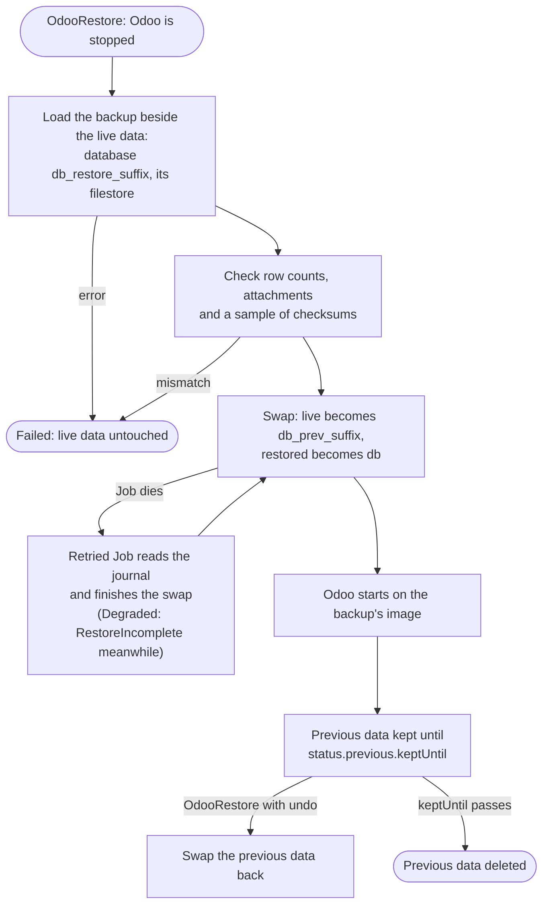

# Restore and undo

A restore replaces the instance's database and filestore in place:

```yaml
apiVersion: odoo.abugharbia.com/v1
kind: OdooRestore
metadata:
  name: back-to-friday
  namespace: shop
spec:
  odooDeployment: my-odoo
  backup: my-odoo-2026-10-17        # or snapshotID: <id> in the instance's store
  keepPrevious: 72h                 # default spec.backup.restore.keepPrevious (72h)
```

Odoo is stopped; the backup is loaded into `<db>_restore_<suffix>` and
`filestore/<db>_restore_<suffix>` beside the live data and checked (every
table's row count against the backup, every attachment's file, a sample of
files against their checksum). Only then are the names swapped: the live data
becomes `<db>_prev_<suffix>` and the restored data takes its place, and Odoo
starts on the image recorded in the backup. A restore that fails before the
swap leaves the live data untouched (`Failed`); one that fails during the swap
is retried until it finishes, with Odoo stopped and the instance `Degraded`
(`RestoreIncomplete`). A restore takes precedence over everything else and
replaces a failed upgrade Job, which makes it the way back from a failed
upgrade. Modules in `spec.modules` that the backup lacks are installed again
afterwards. If `spec.image` differs from the backup's image the usual upgrade
follows; set `spec.image` to the backup's image first to stay on it.

## What happens if something goes wrong

The live data is never edited in place, so a restore can fail without
damaging it, and a Job that dies halfway finishes when it is retried:



## Undo a restore

The replaced data is kept until `status.previous.keptUntil`, then deleted. Until
then the restore can be undone:

```yaml
spec:
  odooDeployment: my-odoo
  undo: back-to-friday
```

Only the latest restore can be undone. Deleting an OdooRestore deletes the data
it kept.
