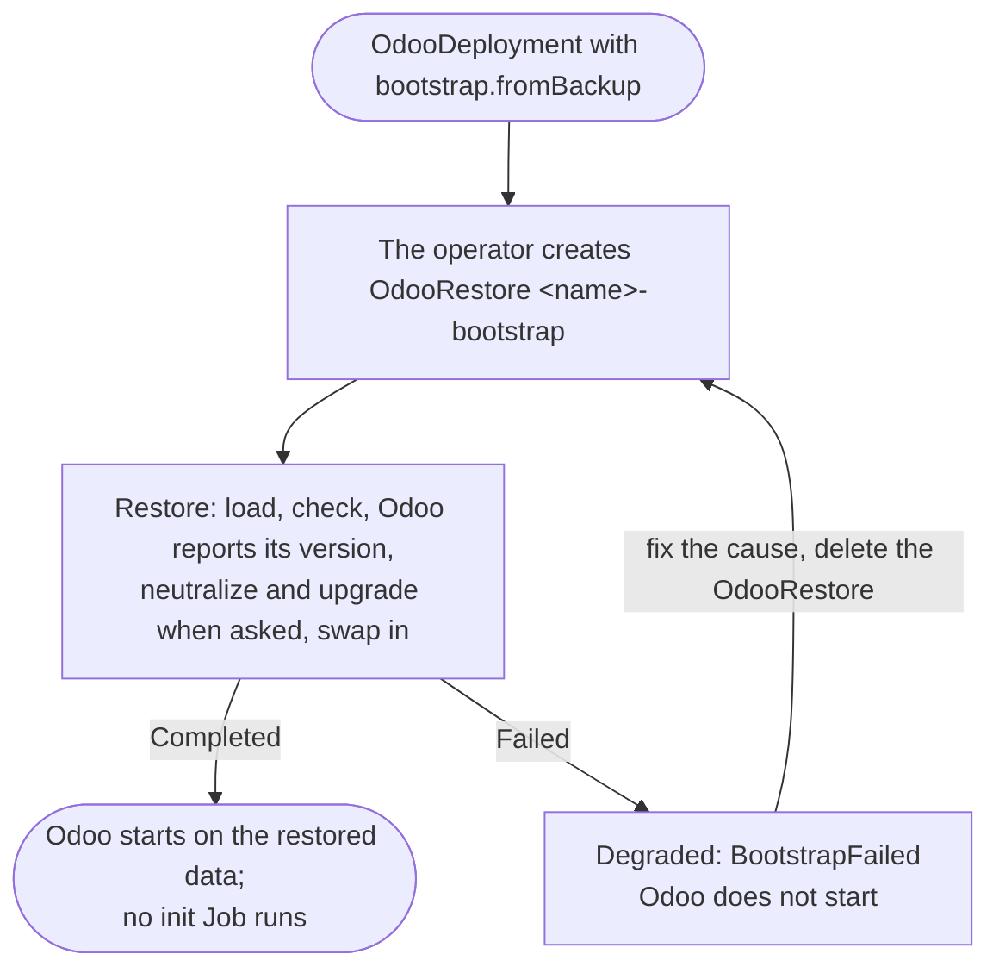

# Start an instance from a backup

`spec.bootstrap.fromBackup` makes a new instance's first database from a
backup instead of a fresh `odoo -i`. It is how an Odoo that runs elsewhere
moves onto the operator, and how a staging copy of production is made.



## Move an existing Odoo

### 1. Take a backup

Take a zip backup, with its filestore, from the Odoo you are moving: in the
database manager (`/web/database/manager`, **Backup**, format **zip**), or:

```sh
curl -X POST -F master_pwd='<master password>' -F name=<database> -F backup_format=zip \
  -o shop_2026-10-01.zip https://odoo.example.com/web/database/backup
```

The new instance must run the same Odoo series (an 18.0 backup needs an 18.0
image) with the same custom modules in its image: the restore asks the
instance's own Odoo for its version and refuses a backup of another series.
A `.dump` backup works too, but holds no filestore, so the instance starts
without its attachment files.

### 2. Put it in a read-only store

Copy the file to a bucket, SFTP folder, NFS export or volume, and describe it
with a [read-only store](backup-stores.md#read-only-stores). A store of only
backup files needs no encryption key:

```sh
aws s3 cp shop_2026-10-01.zip s3://odoo-imports/shop/
```

```yaml
apiVersion: odoo.abugharbia.com/v1
kind: OdooBackupStore
metadata:
  name: imports
  namespace: shop
spec:
  s3:
    endpoint: https://s3.example.com
    bucket: odoo-imports
    credentialsSecret: { name: imports-credentials }   # read-only credentials are enough
  readOnly: true
```

Wait until `kubectl -n shop get odoobackupstore imports` shows it `Ready`.

### 3. Create the instance

```yaml
apiVersion: odoo.abugharbia.com/v1
kind: OdooDeployment
metadata:
  name: my-odoo
  namespace: shop
spec:
  image: registry.example.com/my-odoo:18.0     # the same series and modules as the backup
  modules: [base]                              # modules the backup lacks are installed after it
  bootstrap:
    fromBackup:
      store: imports
      path: shop/shop_*.zip                    # the newest match by name
  # database, odooFilestore, ingress… as for any instance
```

The operator creates the database and the filestore volume, then the
OdooRestore `my-odoo-bootstrap` instead of the init Job. The database must
not exist yet: a bootstrap only fills a database the operator has just
created (see [An existing database](#an-existing-database)). Follow it:

```sh
kubectl -n shop get odoorestore my-odoo-bootstrap -w
kubectl -n shop get odoodeployment my-odoo -o jsonpath='{.status.bootstrap}'
```

When the restore is `Completed`, `status.bootstrap.completed` is true and
Odoo starts on the restored data, on `spec.image`. The data keeps the module
versions of the backup: when `spec.image` holds newer versions of its modules,
add `upgrade: true` under `fromBackup` and the restore upgrades them
(`spec.upgrade.modules`, or all) before Odoo first starts. See
[Upgrade the restored data](restore.md#upgrade-the-restored-data). `status.file` on the
OdooRestore names the file a pattern picked, and `status.warnings` lists what
the checks found.

### 4. After the move

Check the data in Odoo, then point users at the new instance and
[set up backups](production-backups.md). The bootstrap runs once: changing or
removing `spec.bootstrap` afterwards changes nothing, and deleting the
OdooRestore only deletes the empty database it replaced, once
`keepPrevious` has passed. The read-only store can then go. The OdooRestore
`<name>-bootstrap` belongs to the instance: deleting the instance deletes it,
and drops the empty database it kept along with the instance's own (when
`deletionPolicy` is `Delete`), so a new instance of the same name starts its
own bootstrap.

## Make a staging copy of production

Start a second instance from production's own backups, neutralized so it
sends no mail, runs no scheduled actions and takes no payments. Give the
staging namespace a read-only store with the same location and key as
production's store:

```yaml
apiVersion: odoo.abugharbia.com/v1
kind: OdooBackupStore
metadata:
  name: production-backups
  namespace: staging
spec:
  s3:
    endpoint: https://s3.example.com
    bucket: odoo-backups
    path: production
    credentialsSecret: { name: s3-readonly-credentials }
  encryptionKeySecret: { name: production-backup-key, key: password }
  readOnly: true
---
apiVersion: odoo.abugharbia.com/v1
kind: OdooDeployment
metadata:
  name: my-odoo
  namespace: staging
spec:
  image: registry.example.com/my-odoo:18.0
  bootstrap:
    fromBackup:
      store: production-backups
      path: shop/my-odoo          # production's repository: <namespace>/<name>
      tags: [kind=scheduled]      # the newest scheduled backup
      neutralize: true
  # …
```

To refresh it later, restore into it again with an
[OdooRestore](restore.md#restore-a-backup-from-elsewhere) using the same
`from` and `neutralize: true`.

## An existing database

A bootstrap never restores over a database the operator did not create.
When the database `spec.database` names already exists, the operator adopts
it (`status.database.provisionedBy: external`, see
[Databases](../concepts/databases.md)) and does not bootstrap: no OdooRestore
is created, no init Job runs and Odoo does not start. The instance stays
`Pending`, `Degraded` with reason `BootstrapFailed` and a message naming the
database. This protects data a previous instance left behind, for example
one deleted with `deletionPolicy: Retain`. Then either:

- remove `spec.bootstrap`, and Odoo runs the existing database (an init Job
  installs the `spec.modules` it lacks, as for any adopted database); or
- replace its data deliberately: create an [OdooRestore](restore.md) with
  the same source first, then remove `spec.bootstrap`. A restore goes before
  everything else, so it runs before Odoo or an init Job touches the
  database.

A bootstrap OdooRestore that already existed but had not started is marked
`Failed` with the same message, so it never runs later as an ordinary
restore.

## When the bootstrap fails

A failed restore leaves the instance `Degraded` with reason `BootstrapFailed`
and the restore's message, and Odoo does not start: the operator never
initializes an empty database in its place. Read the OdooRestore's
`status.message` and the Job log it names, fix the cause (the file, the
store, the image's Odoo series), then delete the OdooRestore. The operator
creates it again and retries.

```sh
kubectl -n shop get odoorestore my-odoo-bootstrap -o jsonpath='{.status.message}'
kubectl -n shop delete odoorestore my-odoo-bootstrap
```
