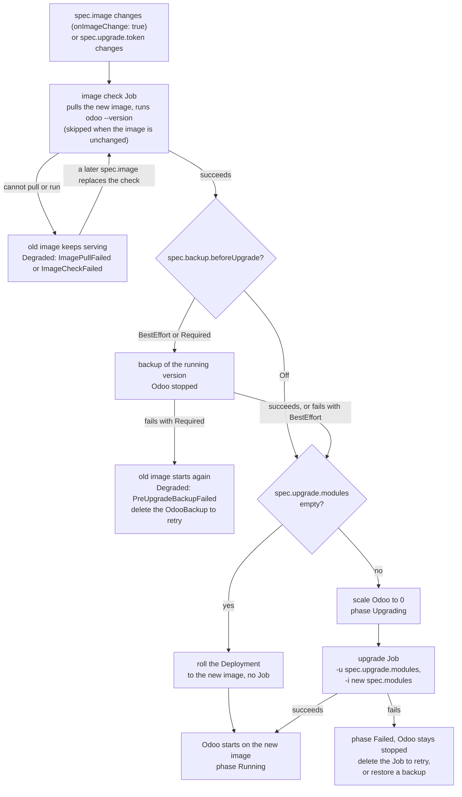

# Upgrade Odoo

An upgrade runs Odoo's `-u` on the database in a Job, with the Deployment scaled to zero, whenever the image changes or you ask for it.

- `spec.upgrade.onImageChange: true` (default): every `spec.image` change runs
  an upgrade Job with `-u <spec.upgrade.modules>` before the Deployment rolls
  to the new image. New entries in `spec.modules` are installed in the same Job.
- Empty `spec.upgrade.modules` rolls the new image without a Job.
- **A new image is pulled before anything stops.** When `spec.image` changes on
  a running instance, a short `<name>-image-<hash>` Job runs
  `<odooCommand> --version` on it first, without the filestore or the config.
  Only once it succeeds is the Deployment scaled down (or rolled). Until then
  the old image keeps serving; if the image cannot be pulled `Degraded` is
  `ImagePullFailed` (or `ImageCheckFailed` when it pulled but did not run), and
  a later `spec.image` replaces the check. This is what keeps an instance up
  when its image tag is published before the image is pushed, or never is.
- An init or upgrade Job whose pod cannot pull its image is reported as
  `ImagePullFailed`. If `spec.image` changes meanwhile, the Job is replaced
  by one for the new image: its container never started, so nothing touched
  the database.
- For production set `onImageChange: false` and bump `spec.upgrade.token` to
  run the upgrade on demand. A `spec.image` change then does nothing until the
  token changes, with one exception: a new entry in `spec.modules` is installed
  by a Job on `spec.image`, and the instance moves to that image without `-u`.
- **A backup before each upgrade.** With `spec.backup.beforeUpgrade` set to
  `BestEffort` or `Required` (default `Off`; it needs `spec.backup.stores`),
  a new image or upgrade token first gets an OdooBackup named
  `<name>-pre-upgrade-<yyyymmdd-hhmmss>` (label
  `odoo.abugharbia.com/backup-kind: pre-upgrade`), taken once the new image
  has pulled, before the upgrade Job or the roll. Odoo is stopped for it
  whatever `consistency` says, and stays stopped until the upgrade Job starts;
  the [maintenance page](maintenance-page.md) shows the backup as the first
  step of the update. `status.preUpgradeBackup` names it. If it fails:
    - `BestEffort` upgrades anyway, with a `PreUpgradeBackupFailed` warning
      event;
    - `Required` starts the old image again and sets `Degraded`
      (`PreUpgradeBackupFailed`) with the backup's message. Deleting that
      OdooBackup tries again, and so does a new `spec.image` or token.

  Retention keeps the newest `retention.preUpgrade` of these (default 5).
  Restoring one is the way back from an upgrade that went wrong.
- A failed Job stays, with Odoo stopped, until you delete it: deleting it
  retries the upgrade. Read its log first, or restore a backup instead.
- `spec.jobs` bounds the Jobs (`activeDeadlineSeconds`, `backoffLimit`). Its
  `ttlSecondsAfterFinished` applies to the backup, restore and drill Jobs; the
  init and upgrade Jobs have none, as the operator deletes them when they
  succeed and keeps a failed one until you delete it.

A failed upgrade can be rolled back by [restoring a backup](restore.md), such as the one `beforeUpgrade` took: a restore replaces a failed init or upgrade Job.
